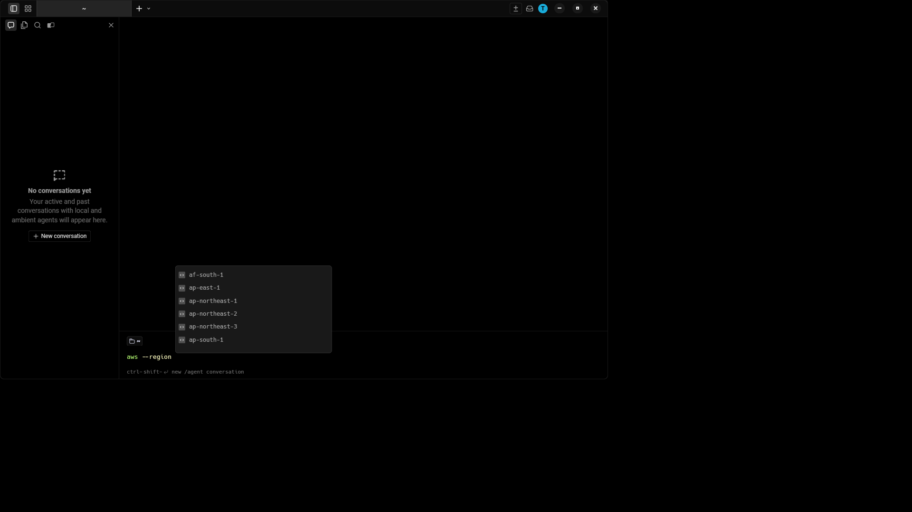
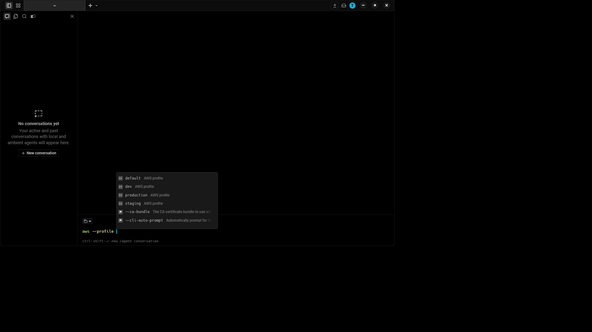

# cmdforge

## JSON Command Signatures

The command signatures, a.k.a. "specs", are stored in the `./cmdforge/json`.
All the specs in `./cmdforge/json/*.json` are hand-written.
Those which are generated programmatically are in `./cmdforge/json/autogenerated/**/*.json`.
Currently, we only autogenerate specs for PowerShell cmdlets.
You can trigger this process with:

```sh
cargo run --bin autogenerate_powershell
```

This must be rerun any time we change our autogeneration logic or Microsoft updates PowerShell's cmdlets.

When making changes to this script, put the git hunks for the autogenerated specs into a separate commit to make PR review easier.

### Overriding Autogenerated Commands

We often need to augment autogenerated specs with hand-written data.
Hand-written data cannot be defined in an autogenerated file, but must live in a separate, persistent set of files.
That is what `./cmdforge/json/overrides/**/*.json` is for.
When running the autogeneration script, it'll check this dir and merge the data there into the generated result.

You can _kind of_ think of the override process as a recursive object merge _a.la._ [Lodash's merge](https://lodash.com/docs/latest#merge), but this isn't totally accurate.
Options' names are not object keys, and so a true recursive merge isn't the semantics we want.
Furthermore, positional arguments are arrays and we need the ability to override at arbitrary positions, e.g. override argument 2 without needing to override 0 and 1.
Options are therefore matched by the `OptionOverrides::name` field and positional arguments are matched by `ArgOverrides::index`, e.g. for PowerShell's `Set-Location` cmdlet:

```json
{
  "args": [
    {
      "index": 0,
      "template": ["folders"]
    }
  ],
  "options": [
    {
      "name": "-Path",
      "args": {
        "index": 0,
        "template": ["folders"]
      }
    },
    {
      "name": "-LiteralPath",
      "args": {
        "index": 0,
        "template": ["folders"]
      }
    }
  ]
}
```

**Note:** Overrides for all fields on `fig_types::{Arg, Option}` may not be implemented yet.
At the time of writing, _only_ `template` is supported.
Others will need to be added as needed.

## Completion Screenshots

Completions in a Cognix session, using the `aws` spec and its generator.

`aws --region` — AWS regions offered as static suggestions:



`aws --profile` — profiles resolved from `~/.aws/config` and `~/.aws/credentials` by the `aws` generator, each labeled with its source:



`aws --output` — output formats:


## License

This project is licensed under the MIT License. See the LICENSE file for details. Many of the signatures were adapted from Fig (https://github.com/withfig/autocomplete), which is also licensed under the MIT License.
